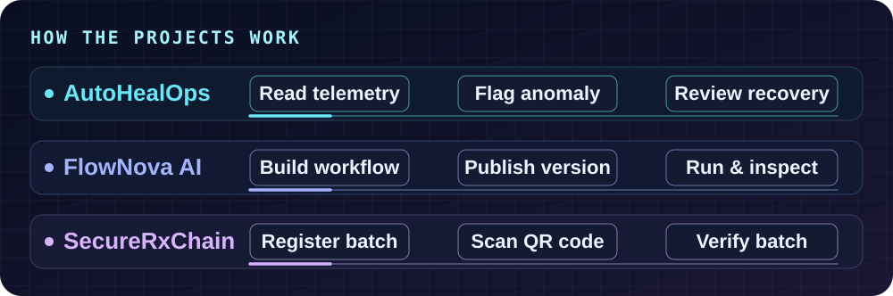

<!-- Repository-hosted SVG animations; no scripts or embedded iframes. -->

  

  <a href="#about">About</a> &nbsp; / &nbsp;
  <a href="#featured-work">Featured work</a> &nbsp; / &nbsp;
  <a href="#engineering">Engineering</a> &nbsp; / &nbsp;
  <a href="#toolkit">Toolkit</a> &nbsp; / &nbsp;
  <a href="#ai-radar">AI Radar</a> &nbsp; / &nbsp;
  <a href="#explore">Explore</a> &nbsp; / &nbsp;
  <a href="#connect">Connect</a>
  &nbsp; / &nbsp; <a href="#research">Research</a>

  
  
  

  

  
   
  Always curious. Always building.

<a href="https://manikantbindass.github.io/manikantbindass/"><strong>Visit my portfolio ↗</strong></a> · <a href="https://github.com/manikantbindass?tab=repositories">Browse my repositories ↗</a>

  

## Complex ideas. Useful software.

I'm **Manikant Kumar**, a developer working across **AI-augmented full stack development, backend engineering, and blockchain smart contracts**. I turn complex problems into clear architectures, connected workflows, and useful software.

My current focus is **agentic AI, retrieval-augmented generation, secure APIs, and scalable backend systems**. I care about how the pieces work together—from the interface and data layer to authentication, deployment, and observability.

<table>
<tr>
<td width="50%" valign="top">
<h3>01 / Intelligent applications</h3>

LLM API integrations, semantic search, RAG pipelines, vector databases, multimodal interfaces, and agents that work with tools.

</td>
<td width="50%" valign="top">
<h3>02 / Backend &amp; architecture</h3>

Java, Spring Boot, Python APIs, .NET, microservices, authentication, and system design with reliability and maintainability in mind.

</td>
</tr>
<tr>
<td width="50%" valign="top">
<h3>03 / Full stack experiences</h3>

MERN, TypeScript, React, Vue, and Three.js—connecting thoughtful interfaces to the systems behind them.

</td>
<td width="50%" valign="top">
<h3>04 / Web3 &amp; delivery</h3>

Solidity smart contracts, Ethers.js, and blockchain integrations, alongside Docker, Kubernetes, cloud platforms, and CI/CD.

</td>
</tr>
</table>

  
   
  <strong>Meet ManikantChatsU</strong> · Explore my profile through an AI × Web3 assistant.

## Featured work

  

<table>
<tr>
<td width="50%" valign="top">

<h3>AutoHealOps</h3>

<strong>KUBERNETES · AIOPS</strong>

Explore cluster telemetry, detect anomalies, and review guarded recovery actions in a self-healing Kubernetes simulator.

<a href="https://autohealops.vercel.app"><strong>Live demo ↗</strong></a> · <a href="https://github.com/manikantbindass/AutoHealOps">Source</a>

</td>
<td width="50%" valign="top">

<h3>FlowNova AI</h3>

<strong>WORKFLOW AUTOMATION · FULL STACK</strong>

Build workflows on a visual canvas, publish versions, run them, and inspect the results from each node.

<a href="https://flownova-ai.vercel.app"><strong>Live demo ↗</strong></a> · <a href="https://github.com/manikantbindass/FlowNovaAI">Source</a>

</td>
</tr>
<tr>
<td width="50%" valign="top">
<h3>MathLens</h3>

<strong>MATH VISUALIZATION · MODEL ANALYSIS</strong>

An interactive workbench for mathematical concepts behind machine learning, from loss surfaces to optimization.

<a href="https://mathlens-wine.vercel.app"><strong>Open MathLens ↗</strong></a> · <a href="https://github.com/manikantbindass/mathlens">Source</a>

</td>
<td width="50%" valign="top">
<h3>NeuroMap AI</h3>

<strong>SCIENTIFIC SOFTWARE · REPRODUCIBLE ML</strong>

A research workspace for visualizing brain images and running reproducible ML experiments with synthetic data.

<a href="https://github.com/manikantbindass/NeuroMap.AI"><strong>Explore the project ↗</strong></a>

</td>
</tr>
<tr>
<td width="50%" valign="top">
<h3>SecureRxChain</h3>

<strong>SMART CONTRACTS · SUPPLY CHAIN</strong>

A project exploring pharmaceutical batch traceability with Solidity contracts, QR verification, and anomaly detection.

<a href="https://github.com/manikantbindass/SecureRxChain-Blockchain-Based-Drug-Supply-Chain-Counterfeit-Medicine-Prevention-System"><strong>Explore the project ↗</strong></a>

</td>
<td width="50%" valign="top">
<h3>LeetCode AI Sync</h3>

<strong>DEVELOPER TOOLS · BROWSER EXTENSION</strong>

A TypeScript Chrome extension that sends accepted LeetCode solutions to GitHub and generates versions in other programming languages for practice.

<a href="https://github.com/manikantbindass/Leetcode-GitPush-extension"><strong>Extension source ↗</strong></a> · <a href="https://github.com/manikantbindass/DSA-Preparation-FAANG">Solution archive</a>

</td>
</tr>
</table>

## Engineering, with the whole system in mind

| Layer | What I focus on |
| :--- | :--- |
| **Experience** | Responsive interfaces, full stack applications, clear API contracts, and useful interactions. |
| **Intelligence** | Embeddings, retrieval, model integration, agent orchestration, and tool-driven workflows. |
| **Services** | Java / Spring Boot, Python / FastAPI, .NET, Node.js, microservices, and secure authentication. |
| **Data** | PostgreSQL, MongoDB, SQL, Redis, vector search, Pandas, and NumPy. |
| **Delivery** | Containers, Kubernetes, CI/CD, Linux, AWS, Azure, and learning GCP. |
| **Trust** | API security, DevSecOps, prompt injection defense, data leakage prevention, and smart contract security. |

**How I approach a build:** understand the problem → define service and data boundaries → build a useful slice → test the behavior → deploy and observe → improve.

<strong>Currently exploring</strong> — the learning never stops

- **AI foundations:** deep learning, reinforcement learning, neural networks, model training, and decision systems.
- **Agent workflows:** LangGraph, AutoGen, CrewAI, n8n, automation, and coding agents.
- **Retrieval and multimodality:** FAISS, Pinecone, Weaviate, semantic search, vision, speech, and image + text integration.
- **Systems fundamentals:** DSA, OOP, concurrency, memory, operating systems, Linux, DNS, HTTPS, and domain setup.
- **ML operations:** MLflow, reproducible workflows, deployment strategy, and monitoring.

## My toolkit

  
    
  
    
  

| Focus | Tools & technologies |
| :--- | :--- |
| **Model APIs** | OpenAI · Anthropic Claude · Google Gemini · DeepSeek · Mistral · Hugging Face |
| **RAG & agents** | LangChain · LlamaIndex · LangGraph · AutoGen · CrewAI · n8n |
| **Retrieval & ML** | Pinecone · FAISS · Weaviate · PyTorch · TensorFlow · scikit-learn · MLflow |
| **Web3** | Solidity · Ethers.js · MetaMask · Solana |
| **Everyday engineering** | Git · GitHub · GitLab · GitKraken · Docker · Kubernetes · CI/CD |

<strong>More of the stack</strong>

C, Go, HTML, CSS, Express, Three.js, NumPy, Pandas, pylab, Nginx, Bash, Jenkins, Terraform, and enterprise programming patterns. GCP is part of my current learning path.

## AI radar · from models to agents

A curated timeline of the releases shaping how I think about AI engineering.

  

### Models I’m tracking

**Last checked November 27, 2026.** Dates are in 2026 and mark the listed release or availability milestone. The table links to the providers’ announcements and model docs.

| Date | Model | Why it’s worth tracking | Access |
| :--- | :--- | :--- | :--- |
| Nov 19 | [Genie 4](https://aistudio.google.com/docs/models/genie-4) | Generates steerable worlds with live video and synchronized audio from text or an image. | Paid Interactions API |
| Nov 18 | [Gemini 4 Neon](https://aistudio.google.com/docs/models/gemini-4-neon) | Fast multimodal reasoning for coding and knowledge work, with a 1M-token context window. | Paid Gemini API |
| Nov 17 | [GPT-6.2 Astra & Sol](https://openai.com/index/introducing-gpt-6-2-astra-sol/) | Astra for harder coding and reasoning. Sol for faster, lower-cost multistep work. | OpenAI API |
| Nov 16 | [Qwen4-Max](https://qwen.ai/blog?id=qwen4-max) | Native vision and a 1M-token context window for coding, tool use, and long-running tasks. | QwenCloud API and Token Plan |
| Nov 12 | [Gemini 4 Hydrogen](https://aistudio.google.com/docs/models/gemini-4-hydrogen) | A faster Gemini 4 option for everyday reasoning and high-volume agent workflows. | Free and paid Gemini API tiers |
| Nov 10 | [Gemini 4 Carbon](https://aistudio.google.com/docs/models/gemini-4-carbon) | Reasoning for sustained coding and multimodal work. Generally available as of November 10. | Paid Gemini API |
| Nov 9 | [Claude Fable 5.2 & Mythos 5.2](https://www.anthropic.com/claude-fable-and-mythos-5-2) | Fable handles complex coding and technical work. Mythos is a restricted sibling release. | Fable on Claude Platform and cloud providers. Mythos requires vetted access. |
| Oct 29 | [Mistral Large 4](https://mistral.ai/news/mistral-large-4-oss/) | The open-weight release adds a self-hosting option for multimodal reasoning and coding. | Downloadable weights and hosted API |
| Oct 17 | [DeepSeek V4.1 Flash 1017](https://api-docs.deepseek.com/news/news261017/) | The Flash snapshot updates coding and multimodal understanding. The November API update added search and file inputs. | DeepSeek API via `deepseek-flash` |

For the rest of the Claude lineup, [Opus 5.5](https://www.anthropic.com/claude-opus-5-5) is the general-purpose option for complex work, [Sonnet 5.5](https://www.anthropic.com/claude-sonnet-5-5) balances capability and cost, and [Haiku 5.5](https://www.anthropic.com/claude-haiku-5-5) targets fast, high-volume tasks.

> **My builder takeaway:** evaluate models on the actual workflow—quality, latency, cost, tool reliability, and security—then design routing and fallbacks around the result.

<strong>How I compare models for engineering work</strong>

| Workflow | What I check |
| :--- | :--- |
| **Coding** | Run the same issue and tests across models. Review correctness, scope of changes, and time to a passing result. |
| **Retrieval** | Use the same document set. Measure citation accuracy, how well answers reflect the sources, and behavior when evidence is missing. |
| **Tool use** | Check argument validity, permission boundaries, retries, and recovery from missing or malformed tool responses. |
| **Model routing** | Compare cost per completed task and p95 latency. Track when a smaller model needs to hand off to a stronger one. |

<strong>September–October 2026 release archive</strong>

**Snapshot from November 3, 2026.** The access column records availability at the time of each announcement.

| Announced | Model / release | What changed | Access at announcement |
| :--- | :--- | :--- | :--- |
| **Oct 30, 2026** | [GPT-6 Rosalind Research](https://help.openai.com/en/articles/9624314-model-release-notes) | GPT-6 reasoning for multistep life sciences research. | Limited to approved Research customers; separate approval required. |
| **Oct 28, 2026** | [Gemini 4 Carbon](https://blog.google/innovation-and-ai/models-and-research/gemini-models/introducing-gemini-4-carbon/) | Focus on sustained engineering tasks and cybersecurity defense. | Initial access for selected cyber defenders and trusted partners; broader release pending. |
| **Oct 26, 2026** | [GPT-6.1 Terra](https://help.openai.com/en/articles/9624314-model-release-notes) | Visual reasoning, computer use, and writing. | Rolling out in the API, ChatGPT Work, and Codex. |
| **Oct 13, 2026** | [Gemini 4 Argon](https://aistudio.google.com/docs/changelog) | Coding, agentic workflows, mathematics, and science. | Generally available through the Gemini API. |
| **Oct 7, 2026** | [Claude Haiku 5.5](https://www.anthropic.com/claude-haiku-5-5) | Small model aimed at fast, high-volume workflows. | See official release for platform availability. |
| **Sep 28, 2026** | [Claude Sonnet 5.5](https://www.anthropic.com/claude-sonnet-5-5) | Faster, lower-cost complement to Opus 5.5. | See official release for platform availability. |
| **Sep 22, 2026** | [Claude Opus 5.5](https://www.anthropic.com/claude-opus-5-5) | Agentic coding and knowledge work. | See official release for platform availability. |

<strong>Timeline notes & official sources</strong>

The timeline shows selected milestones. The 2026 “agents + tool use” card marks a shift toward multi-step workflows. The watchlist is maintained by hand.

- **2020:** [GPT-3 paper](https://arxiv.org/abs/2005.14165).
- **2022:** [Introducing ChatGPT](https://openai.com/index/chatgpt/).
- **2023:** [GPT-4](https://openai.com/index/gpt-4-research/).
- **2024:** [GPT-4o](https://openai.com/index/hello-gpt-4o/) · [Claude 3](https://www.anthropic.com/news/claude-3-family).
- **2025:** [DeepSeek-R1](https://deepseek.com/en/news/deepseek-r1/) · [GPT-5](https://openai.com/index/introducing-gpt-5/).
- **2026:** [OpenAI model release notes](https://help.openai.com/en/articles/9624314-model-release-notes) · [Anthropic announcements](https://www.anthropic.com/news) · [Gemini API changelog](https://aistudio.google.com/docs/changelog) · [Gemini 4 Carbon announcement](https://blog.google/innovation-and-ai/models-and-research/gemini-models/introducing-gemini-4-carbon/) · [DeepSeek API updates](https://api-docs.deepseek.com/updates/) · [Mistral release notes](https://docs.mistral.ai/resources/changelogs) · [Alibaba Cloud model updates](https://www.alibabacloud.com/help/en/model-studio/token-plan-product-updates).

## Follow the project trails

Choose a topic to browse matching repositories on my GitHub.

  
  
  
   
  
  
  

### Writing & notes

I share ideas and learning on [Medium](https://medium.com/@manikantbindass) and [DEV](https://dev.to/manikantbindass). Find my wider project links on [Linktree](https://linktr.ee/manikantbindass).

<!-- BLOG-POST-LIST:START -->
<!-- BLOG-POST-LIST:END -->

<strong>GitHub activity</strong>

  

  
  

[Full GitHub activity](https://github.com/manikantbindass?tab=overview) · [Stars and saved repositories](https://github.com/manikantbindass?tab=stars)

Activity cards are provided by external services and may occasionally be unavailable.

<strong>Behind the code</strong>

  

When I'm away from code, you'll often find me reading novels. Curiosity connects both worlds.

## Let's connect

Have an idea involving **AI applications, backend systems, smart contracts, or system design**? Let's talk.

  
  
  
  
  

<strong>More places to find me</strong>

[Instagram](https://instagram.com/manikantbindass) · [Facebook](https://fb.com/manikantbindass) · [Dribbble](https://dribbble.com/manikantbindass) · [CodeChef](https://www.codechef.com/users/manikantbindass) · [Codeforces](https://codeforces.com/profile/manikantbindass) · [Topcoder](https://www.topcoder.com/members/manikantbindass) · [Stack Overflow](https://stackoverflow.com/users/manikantbindass)

## Research spotlight · Attention Is All You Need

**Ashish Vaswani et al. · NeurIPS 2017** · [Read the paper](https://arxiv.org/abs/1706.03762) · [PDF](https://arxiv.org/pdf/1706.03762)

The paper introduced the **Transformer** for sequence transduction. Self-attention lets each input position build a representation from other positions in the same sequence. Multi-head attention learns several sets of projections for these interactions, and positional encodings give the model information about token order.

  

In this example, **moved** supplies the query. Each query–key dot product is scaled by the square root of the key dimension, then softmax turns the scores into weights. The output is the weighted sum of the corresponding value vectors. In the illustration, **robot** gets the highest weight.

<strong>Three places to start in the paper</strong>

- **Section 3.2** covers scaled dot-product attention and how multiple heads combine different projections. [Read Section 3.2](https://arxiv.org/html/1706.03762#S3.SS2)
- **Section 3.5** shows how the original model adds sinusoidal position information to token embeddings. [Read Section 3.5](https://arxiv.org/html/1706.03762#S3.SS5)
- **Section 4** compares self-attention with recurrent and convolutional layers, including parallelism, compute cost, and the path between positions. [Read Section 4](https://arxiv.org/html/1706.03762#S4)

  

