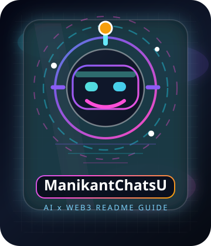

<!-- Repository-hosted SVG animations; no scripts or embedded iframes. -->

  

  <a href="#about">About</a> &nbsp; / &nbsp;
  <a href="#engineering">Engineering</a> &nbsp; / &nbsp;
  <a href="#toolkit">Toolkit</a> &nbsp; / &nbsp;
  <a href="#ai-radar">AI Radar</a> &nbsp; / &nbsp;
  <a href="#explore">Explore</a> &nbsp; / &nbsp;
  <a href="#connect">Connect</a>

  
  
  

  

  
   
  Always curious. Always building.

<a href="https://manikantbindass.github.io/manikantbindass/"><strong>Visit my portfolio ↗</strong></a> · <a href="https://github.com/manikantbindass?tab=repositories">Browse my repositories ↗</a>

## Complex ideas. Useful software.

I'm **Manikant Kumar**, a developer working across **AI-augmented full stack development, backend engineering, and blockchain smart contracts**. I turn complex problems into clear architectures, connected workflows, and useful software.

My current focus is **agentic AI, retrieval-augmented generation, secure APIs, and scalable backend systems**. I care about how the pieces work together—from the interface and data layer to authentication, deployment, and observability.

<table>
<tr>
<td width="50%" valign="top">
<h3>01 / Intelligent applications</h3>

LLM API integrations, semantic search, RAG pipelines, vector databases, multimodal interfaces, and agents that work with tools.

</td>
<td width="50%" valign="top">
<h3>02 / Backend &amp; architecture</h3>

Java, Spring Boot, Python APIs, .NET, microservices, authentication, and system design with reliability and maintainability in mind.

</td>
</tr>
<tr>
<td width="50%" valign="top">
<h3>03 / Full stack experiences</h3>

MERN, TypeScript, React, Vue, and Three.js—connecting thoughtful interfaces to the systems behind them.

</td>
<td width="50%" valign="top">
<h3>04 / Web3 &amp; delivery</h3>

Solidity smart contracts, Ethers.js, and blockchain integrations, alongside Docker, Kubernetes, cloud platforms, and CI/CD.

</td>
</tr>
</table>

  
   
  <strong>Meet ManikantChatsU</strong> · Explore my profile through an AI × Web3 assistant.

## Engineering, with the whole system in mind

| Layer | What I focus on |
| :--- | :--- |
| **Experience** | Responsive interfaces, full stack applications, clear API contracts, and useful interactions. |
| **Intelligence** | Embeddings, retrieval, model integration, agent orchestration, and tool-driven workflows. |
| **Services** | Java / Spring Boot, Python / FastAPI, .NET, Node.js, microservices, and secure authentication. |
| **Data** | PostgreSQL, MongoDB, SQL, Redis, vector search, Pandas, and NumPy. |
| **Delivery** | Containers, Kubernetes, CI/CD, Linux, AWS, Azure, and learning GCP. |
| **Trust** | API security, DevSecOps, prompt injection defense, data leakage prevention, and smart contract security. |

**How I approach a build:** understand the problem → define service and data boundaries → build a useful slice → test the behavior → deploy and observe → improve.

<strong>Currently exploring</strong> — the learning never stops

- **AI foundations:** deep learning, reinforcement learning, neural networks, model training, and decision systems.
- **Agent workflows:** LangGraph, AutoGen, CrewAI, n8n, automation, and coding agents.
- **Retrieval and multimodality:** FAISS, Pinecone, Weaviate, semantic search, vision, speech, and image + text integration.
- **Systems fundamentals:** DSA, OOP, concurrency, memory, operating systems, Linux, DNS, HTTPS, and domain setup.
- **ML operations:** MLflow, reproducible workflows, deployment strategy, and monitoring.

## My toolkit

  
    
  
    
  

| Focus | Tools & technologies |
| :--- | :--- |
| **Model APIs** | OpenAI · Anthropic Claude · Google Gemini · DeepSeek · Mistral · Hugging Face |
| **RAG & agents** | LangChain · LlamaIndex · LangGraph · AutoGen · CrewAI · n8n |
| **Retrieval & ML** | Pinecone · FAISS · Weaviate · PyTorch · TensorFlow · scikit-learn · MLflow |
| **Web3** | Solidity · Ethers.js · MetaMask · Solana |
| **Everyday engineering** | Git · GitHub · GitLab · GitKraken · Docker · Kubernetes · CI/CD |

<strong>More of the stack</strong>

C, Go, HTML, CSS, Express, Three.js, NumPy, Pandas, pylab, Nginx, Bash, Jenkins, Terraform, and enterprise programming patterns. GCP is part of my current learning path.

## AI radar · from models to agents

A curated timeline of the releases shaping how I think about AI engineering.

  

### Recent releases worth tracking

**Last checked: November 3, 2026.** This is a curated snapshot; availability varies by product and access tier.

| Announced | Model / release | What changed | Access at announcement |
| :--- | :--- | :--- | :--- |
| **Oct 30, 2026** | [GPT-6 Rosalind Research](https://help.openai.com/en/articles/9624314-model-release-notes) | GPT-6 reasoning for multistep life sciences research. | Limited to approved Research customers; separate approval required. |
| **Oct 28, 2026** | [Gemini 4 Carbon](https://blog.google/innovation-and-ai/models-and-research/gemini-models/introducing-gemini-4-carbon/) | Focus on sustained engineering tasks and cybersecurity defense. | Initial access for selected cyber defenders and trusted partners; broader release pending. |
| **Oct 26, 2026** | [GPT-6.1 Terra](https://help.openai.com/en/articles/9624314-model-release-notes) | Visual reasoning, computer use, and writing. | Rolling out in the API, ChatGPT Work, and Codex. |
| **Oct 13, 2026** | [Gemini 4 Argon](https://aistudio.google.com/docs/changelog) | Coding, agentic workflows, mathematics, and science. | Generally available through the Gemini API. |
| **Oct 7, 2026** | [Claude Haiku 5.5](https://www.anthropic.com/claude-haiku-5-5) | Small model aimed at fast, high-volume workflows. | See official release for platform availability. |
| **Sep 28, 2026** | [Claude Sonnet 5.5](https://www.anthropic.com/claude-sonnet-5-5) | Faster, lower-cost complement to Opus 5.5. | See official release for platform availability. |
| **Sep 22, 2026** | [Claude Opus 5.5](https://www.anthropic.com/claude-opus-5-5) | Agentic coding and knowledge work. | See official release for platform availability. |

> **My builder takeaway:** evaluate models on the actual workflow—quality, latency, cost, tool reliability, and security—then design routing and fallbacks around the result.

<strong>Timeline notes & official sources</strong>

Selected milestones, rather than an exhaustive history or a benchmark ranking. The 2026 “agents + tool use” card describes an engineering direction, not a single model release. The release table is a dated snapshot and does not update automatically.

- **2020:** [GPT-3 paper](https://arxiv.org/abs/2005.14165).
- **2022:** [Introducing ChatGPT](https://openai.com/index/chatgpt/).
- **2023:** [GPT-4](https://openai.com/index/gpt-4-research/).
- **2024:** [GPT-4o](https://openai.com/index/hello-gpt-4o/) · [Claude 3](https://www.anthropic.com/news/claude-3-family).
- **2025:** [DeepSeek-R1](https://deepseek.com/en/news/deepseek-r1/) · [GPT-5](https://openai.com/index/introducing-gpt-5/).
- **2026:** [OpenAI model release notes](https://help.openai.com/en/articles/9624314-model-release-notes) · [Anthropic announcements](https://www.anthropic.com/news) · [Gemini API changelog](https://aistudio.google.com/docs/changelog) · [Gemini 4 Carbon announcement](https://blog.google/innovation-and-ai/models-and-research/gemini-models/introducing-gemini-4-carbon/).

## Follow the project trails

Choose a topic to browse matching repositories on my GitHub.

  
  
  
   
  
  
  

### Writing & notes

I share ideas and learning on [Medium](https://medium.com/@manikantbindass) and [DEV](https://dev.to/manikantbindass). Find my wider project links on [Linktree](https://linktr.ee/manikantbindass).

<!-- BLOG-POST-LIST:START -->
<!-- BLOG-POST-LIST:END -->

<strong>GitHub activity</strong>

  

  
  

Activity cards are provided by external services and may occasionally be unavailable.

<strong>Behind the code</strong>

  

When I'm away from code, you'll often find me reading novels. Curiosity connects both worlds.

## Let's connect

Have an idea involving **AI applications, backend systems, smart contracts, or system design**? Let's talk.

  
  
  
  
  

<strong>More places to find me</strong>

[Instagram](https://instagram.com/manikantbindass) · [Facebook](https://fb.com/manikantbindass) · [Dribbble](https://dribbble.com/manikantbindass) · [CodeChef](https://www.codechef.com/users/manikantbindass) · [Codeforces](https://codeforces.com/profile/manikantbindass) · [Topcoder](https://www.topcoder.com/members/manikantbindass) · [Stack Overflow](https://stackoverflow.com/users/manikantbindass)

  

